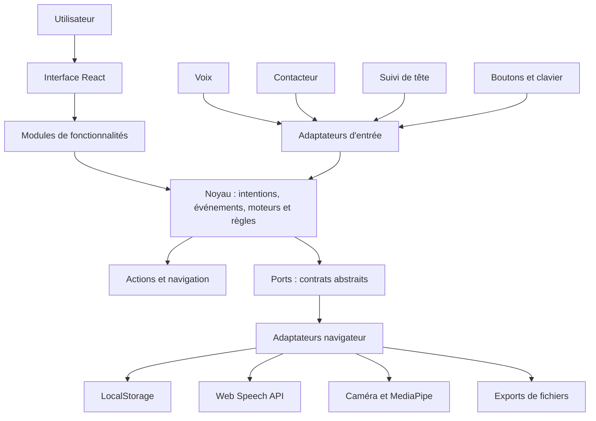

# MainLibre

**Interface web d'accessibilité pilotée par plusieurs moyens de commande.**

MainLibre est un prototype qui explore différentes façons d'utiliser une interface lorsque la souris ou le clavier classique sont difficiles à employer : commande vocale, contacteur, suivi de tête et sélection par boutons.

Le projet met l'accent sur une idée simple : l'utilisateur doit pouvoir déclencher les mêmes actions avec des moyens de commande différents. La logique de l'application ne doit donc pas dépendre directement d'un microphone, d'une touche ou d'une caméra.

> **État du projet :** prototype pédagogique et expérimental. MainLibre n'est pas un dispositif médical certifié et son accessibilité doit encore être évaluée avec des personnes concernées.

## Sommaire

- [Fonctionnalités](#fonctionnalités)
- [Architecture](#architecture)
- [Technologies](#technologies)
- [Installation et lancement](#installation-et-lancement)
- [Vérification et tests](#vérification-et-tests)
- [Données et confidentialité](#données-et-confidentialité)
- [Laboratoire d'essais](#laboratoire-dessais)
- [Structure du projet](#structure-du-projet)
- [Limites connues](#limites-connues)
- [Dépannage](#dépannage)

## Fonctionnalités

| Module | Fonction | À savoir |
|---|---|---|
| Voix | Reconnaître des commandes prédéfinies et naviguer dans l'application | Utilise l'API de reconnaissance vocale du navigateur. Ce n'est pas un assistant conversationnel. |
| Navigation par contacteur | Parcourir et sélectionner des éléments avec une touche ou un bouton | Le prototype accepte notamment Espace et Entrée comme entrées clavier. Le moteur peut parcourir des groupes puis les éléments. |
| Clavier virtuel | Composer du texte dans l'application | Le clavier comporte quatre rangées avec les lettres et les commandes espace, suppression et effacement. Le texte reste dans MainLibre ; il n'est pas envoyé automatiquement vers WhatsApp ou une autre application. |
| Suivi de tête | Déplacer un pointeur à partir de la position du visage | Le traitement utilise la caméra et MediaPipe dans le navigateur. |
| Sélection par maintien | Sélectionner une cible en gardant le pointeur dessus | Le délai de maintien est configurable dans le profil. |
| Profils et réglages | Adapter la taille des cibles, le contraste, le balayage et le suivi de tête | Les paramètres sont enregistrés dans le stockage local du navigateur. |
| Laboratoire | Exécuter des tâches et noter des observations d'interaction | Les scénarios sont des essais de prototype, pas une étude clinique. |

## Architecture

MainLibre est organisé en couches. Les fonctionnalités décrivent ce que l'application propose, le noyau contient les règles et les moteurs, et l'infrastructure relie ces règles aux API du navigateur.



### Le principe des intentions communes

Les différents moyens de commande produisent des intentions communes, par exemple `NEXT`, `PREVIOUS`, `SELECT`, `BACK`, `HOME` ou `OPEN`.

Cela sépare deux responsabilités :

1. **La manière de commander** : parler, appuyer sur une touche, déplacer la tête ou cliquer.
2. **L'action demandée** : avancer, sélectionner, revenir en arrière ou ouvrir un écran.

L'interface n'a donc pas besoin de réécrire toute sa logique pour chaque type d'entrée. Un `EventBus` permet de publier des événements et aux composants intéressés de s'y abonner.

Pour la voix, `VoiceMatcher` normalise les expressions (minuscules, accents, ponctuation et espaces), les compare aux commandes prévues et applique un seuil d'acceptation de `0.72`. Une correspondance exacte obtient `1.0` ; une correspondance par inclusion peut obtenir `0.88` ; les autres cas utilisent une similarité entre les mots. Ce mécanisme reconnaît un ensemble de commandes défini par le projet. Il ne remplace pas la compréhension libre d'un assistant conversationnel.

### Ports et Adapters

Le noyau définit des contrats, appelés *ports* (interfaces qui décrivent ce dont le cœur de l'application a besoin). L'infrastructure fournit les implémentations concrètes, appelées *adapters*.

Par exemple, le noyau dépend d'un contrat de stockage, pas directement de `localStorage`. Cette séparation facilite les tests et permet de remplacer une implémentation sans réécrire les règles métier.

### Suivi de tête

Le traitement du pointeur suit plusieurs étapes :

1. Le navigateur demande l'accès à la caméra frontale.
2. `FaceLandmarkerAdapter` transmet les images à un Web Worker.
3. MediaPipe détecte les repères du visage. Le prototype utilise notamment un repère du nez.
4. `PointerFilter` applique la calibration, une zone morte, un gain, une limitation des valeurs et un lissage EMA.
5. `DwellSelector` déclenche une sélection lorsque le pointeur reste suffisamment longtemps sur une cible.

Le Web Worker exécute le traitement de vision dans un contexte séparé du fil principal de l'interface. Cela réduit le risque que les calculs de caméra bloquent les interactions React.

Le filtre utilise notamment les paramètres du profil :

- Gain de tête : `1.25`.
- Zone morte : `0.025`.
- Lissage EMA : `0.28`.
- Délai de maintien (dwell) : environ `1 800 ms` pour le profil de référence.

La formule de lissage est :

```text
résultat = précédent + (cible - précédent) × coefficient
```

Avec un coefficient de `0.28`, le pointeur ne saute pas immédiatement à chaque nouvelle position calculée. Il se rapproche progressivement de la cible.

### Navigation par balayage

`ScanEngine` organise le parcours des éléments dans plusieurs états : `IDLE`, `GROUPS`, `ITEMS`, `ACTIVATED` et `PAUSED`. Il peut parcourir des groupes puis les éléments d'un groupe, ou utiliser un mode plus direct.

Le profil de référence prévoit notamment un intervalle de balayage de `1 800 ms`, un délai initial de `2 400 ms` et une pause automatique après trois cycles. Ces valeurs sont des paramètres de prototype, pas des recommandations médicales universelles.

## Technologies

| Technologie | Utilisation |
|---|---|
| React | Construction de l'interface et des composants |
| TypeScript | Typage des composants, modèles et contrats |
| Vite | Serveur de développement et construction de l'application |
| React Router | Navigation entre les écrans |
| MediaPipe Tasks Vision | Détection des repères du visage |
| Web Worker | Traitement de la vision hors du fil principal de l'interface |
| Web Speech API | Reconnaissance vocale fournie par le navigateur |
| LocalStorage | Conservation locale des paramètres et du journal |
| Vitest et Testing Library | Tests automatisés |
| axe-core | Vérifications automatisées de certains problèmes d'accessibilité |

## Installation et lancement

### Prérequis

- Node.js `22.13` ou une version plus récente compatible avec le projet.
- npm.
- Un navigateur récent. Chrome ou Edge sont recommandés pour les essais de reconnaissance vocale et de caméra.
- Un microphone pour les essais vocaux.
- Une caméra pour le suivi de tête.

### Installer les dépendances

À la racine du dépôt :

```bash
npm ci
```

`npm ci` installe les versions déclarées dans `package-lock.json`. Il est préférable à `npm install` pour reproduire l'environnement prévu par le dépôt.

### Préparer les modèles

```bash
npm run setup:models
```

Cette étape prépare les modèles et les ressources nécessaires au module de vision.

### Démarrer l'application

```bash
npm run dev
```

Vite affiche l'adresse locale dans le terminal. Par défaut, l'application est accessible à l'adresse :

```text
http://localhost:5173
```

Le serveur Vite sert l'interface pour le développement. MainLibre ne possède pas de backend applicatif, de base SQL ou de service d'authentification.

### Arrêter le serveur

Dans le terminal qui exécute Vite, utilisez `Ctrl + C`.

## Vérification et tests

La commande de vérification du projet est :

```bash
npm run verify
```

Elle regroupe les contrôles prévus par le dépôt :

- vérification TypeScript ;
- analyse ESLint ;
- tests automatisés avec Vitest ;
- vérifications de frontières entre les couches ;
- construction de l'application.

Les tests automatisés aident à détecter des régressions dans le code. Ils ne suffisent pas à prouver que l'interface est utilisable par toutes les personnes concernées.

Une évaluation sérieuse doit également inclure des essais manuels avec clavier, contacteur, lecteur d'écran, microphone et caméra, ainsi que des retours de personnes ayant des besoins moteurs différents.

## Données et confidentialité

MainLibre est conçu comme une application locale, sans compte utilisateur ni serveur applicatif.

| Donnée | Stockage ou traitement |
|---|---|
| Paramètres et profil | `localStorage`, clé `mainlibre.settings.v1` |
| Journal du laboratoire | `localStorage`, clé `mainlibre.lab-journal.v1` |
| Images de la caméra | Traitées dans le navigateur par le module de vision et son Web Worker ; elles ne sont pas envoyées à un backend MainLibre |
| Commandes vocales | Le module demande une reconnaissance locale en `fr-FR` lorsque le navigateur la prend en charge |

Le module vocal ne prévoit pas de bascule automatique vers une reconnaissance distante lorsque la reconnaissance locale n'est pas disponible. Le comportement dépend donc des capacités du navigateur utilisé.

Les données conservées dans `localStorage` peuvent être perdues si les données du site sont effacées, si le navigateur est réinitialisé ou si l'utilisateur change de profil de navigateur. Le journal de laboratoire peut être exporté en JSON ou CSV depuis l'application.

La mention de traitement local concerne les images de la caméra utilisées par l'application. Elle ne constitue pas une garantie générale sur les éventuelles télémétries de bibliothèques ou du navigateur.

## Laboratoire d'essais

Le laboratoire permet d'observer l'interaction avec plusieurs tâches : écrire un court texte, déclencher une action d'appel simulée, demander de l'aide et déclencher une action de lumière simulée.

Les scénarios peuvent inclure différentes conditions d'interaction, comme la voix seule ou l'utilisation d'un seul bouton. Ces scénarios servent à explorer le prototype. Ils ne reproduisent pas à eux seuls une situation médicale réelle.

Le journal peut enregistrer notamment :

- la tâche exécutée ;
- la condition d'interaction ;
- le temps écoulé ;
- le nombre d'activations ;
- les erreurs observées.

Le projet inclut également un questionnaire SUS (*System Usability Scale*). Son résultat est un score d'utilisabilité compris entre 0 et 100, et non un pourcentage de réussite. Le calcul suit la méthode habituelle utilisée dans le code : pour les questions impaires, on retire 1 à la réponse ; pour les questions paires, on calcule `5 - réponse`. On additionne les contributions puis on multiplie la somme par `2.5`. Un score SUS ne peut être interprété correctement qu'avec des réponses recueillies auprès de participants.

Les actions d'appel, d'aide et de lumière sont des événements internes simulés. Elles ne déclenchent pas de véritable appel, ne contactent pas les secours et ne pilotent pas de dispositif domotique.

## Structure du projet

```text
src/
├── app/                # Assemblage de l'application, routes et conteneurs
├── core/               # Domaine, intentions, événements, moteurs, ports et règles
├── features/           # Fonctionnalités et écrans
│   ├── hub/
│   ├── voice/
│   ├── scan-nav/
│   ├── keyboard/
│   ├── ar-menu/
│   ├── lab/
│   └── profile/
├── infrastructure/    # Adaptateurs du navigateur et implémentations concrètes
│   ├── speech/
│   ├── vision/
│   ├── switch/
│   ├── storage/
│   ├── theme/
│   └── downloads/
└── shared/             # Composants, configuration, traductions et hooks partagés
```

Quelques fichiers importants :

| Fichier | Responsabilité |
|---|---|
| `src/main.tsx` | Point d'entrée React |
| `src/app/App.tsx` | Assemblage des routes et écrans |
| `src/core/domain/types.ts` | Types du domaine et intentions |
| `src/core/engines/EventBus.ts` | Publication et abonnement aux événements |
| `src/core/engines/ScanEngine.ts` | Moteur de navigation par balayage |
| `src/core/ports/ports.ts` | Contrats utilisés par le noyau |
| `src/infrastructure/vision/FaceLandmarkerAdapter.ts` | Accès caméra et initialisation du suivi du visage |
| `src/infrastructure/vision/face.worker.ts` | Traitement MediaPipe dans un Worker |
| `src/features/ar-menu/model/PointerFilter.ts` | Calibration et filtrage du pointeur |
| `src/features/ar-menu/model/DwellSelector.ts` | Sélection par maintien du pointeur |
| `src/infrastructure/storage/LocalStorageAdapter.ts` | Stockage local des paramètres et du journal |

## Limites connues

- MainLibre est un prototype de démonstration, pas un dispositif médical certifié.
- Aucun backend applicatif, compte, synchronisation multi-appareils ou stockage serveur n'est fourni.
- Les commandes vocales reposent sur des phrases et intentions prévues. `VoiceMatcher` compare les expressions et applique un seuil de correspondance ; il ne comprend pas librement toutes les formulations.
- La reconnaissance vocale dépend des fonctions disponibles dans le navigateur.
- Le suivi de tête dépend de la qualité de la caméra, de l'éclairage, du positionnement et des performances de l'appareil.
- Le pointeur piloté par la souris peut servir à tester certains parcours, mais ne valide pas le suivi de tête réel.
- Le clavier virtuel compose du texte dans l'application ; il ne saisit pas directement dans les applications externes.
- Les actions d'appel, d'aide et de lumière sont simulées.
- Les tests automatisés et les contrôles axe-core ne remplacent pas les tests manuels avec lecteurs d'écran, contacteurs et utilisateurs.
- Aucune étude avec des participants réels n'est établie par le seul contenu du prototype.

## Dépannage

### La commande vocale ne démarre pas

Vérifiez que le navigateur prend en charge la Web Speech API, que le microphone est autorisé et qu'aucune autre application ne l'utilise. Le prototype demande la reconnaissance locale en français (`fr-FR`) ; il ne bascule pas automatiquement vers un service distant si cette fonction n'est pas disponible.

### La caméra ne s'ouvre pas

Vérifiez les autorisations de caméra du navigateur et fermez les autres applications qui l'utilisent. `getUserMedia` nécessite un contexte sécurisé : `localhost` convient pour le développement local ; un site distant doit être servi en HTTPS.

### Le suivi de tête est instable

Essayez un éclairage régulier, gardez le visage visible et relancez la calibration. La zone morte, le gain et le lissage influencent le comportement du pointeur ; une valeur adaptée à une personne ne l'est pas forcément à une autre.

### Le module de vision ne trouve pas ses ressources

Relancez la préparation des modèles :

```bash
npm run setup:models
```

Puis redémarrez le serveur Vite.

### Les paramètres semblent avoir disparu

Vérifiez que vous utilisez le même navigateur et le même profil. Les données sont locales au site ; effacer les données de navigation peut les supprimer.

---

## Pour aller plus loin

Avant toute utilisation au-delà d'une démonstration, il faut compléter les essais techniques par une évaluation d'accessibilité avec des personnes concernées, documenter les résultats et traiter les difficultés observées.
