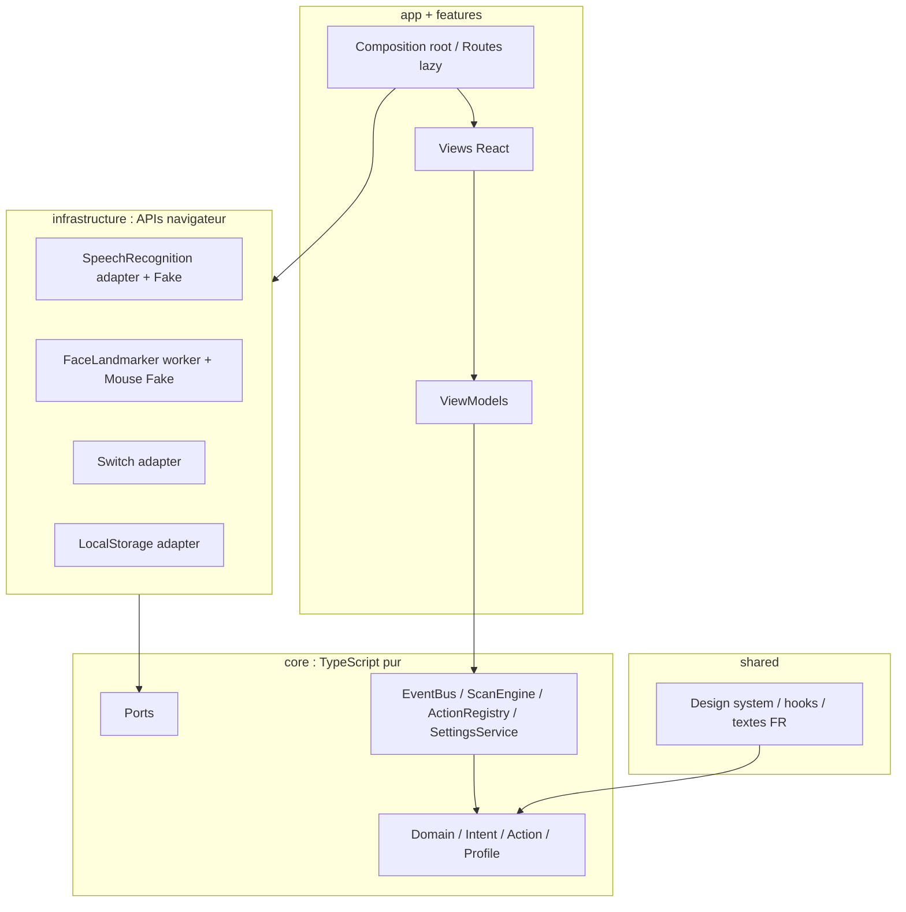
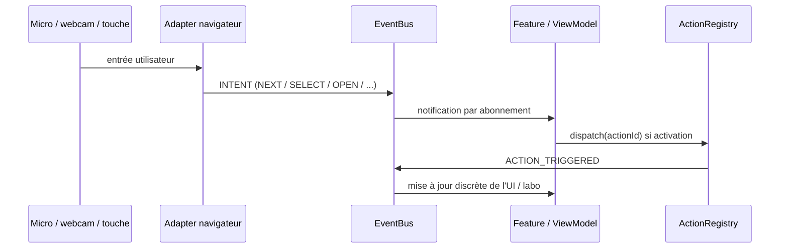

# Architecture MainLibre

## Principes

Application SPA locale, sans backend ni état global externe. Le noyau (`core`) reste TypeScript pur. Les APIs navigateur sont confinées aux adapters `infrastructure`. Les features ne s'importent jamais entre elles ; elles échangent des Intents et événements métier via `EventBus`. Les Views affichent ; les hooks ViewModel orchestrent ; les engines/use-cases restent testables.

## Couches et dépendances



Flux d'un Intent :



## Structure

```text
src/
  app/             composition root, routes, providers, Intent -> navigation
  core/            domain, ports, EventBus, ScanEngine, ActionRegistry, SettingsService
  features/        hub, voice, scan-nav, keyboard, lab, profile, ar-menu
  infrastructure/  speech, vision/worker, switch, storage + Fakes
  shared/          design system, thèmes/tokens, textes, hooks communs
```

## Décisions d'architecture (ADR courts)

1. **D01 : Une SPA unique.** Tous les travaux sont regroupés dans MainLibre pour offrir un parcours cohérent et éviter plusieurs prototypes incohérents.
2. **D02 : Overlay webcam plutôt que WebXR.** Le sujet accepte les overlays ; un flux webcam avec DOM superposé et MediaPipe permet un prototype de RA accessible sur poste de travail sans matériel WebXR spécialisé. Les contrôles sont de vrais boutons HTML, pas des éléments canvas.
3. **D03 : Un moteur commun au scanning et au mono-bouton.** `ScanEngine` ne connaît que des IDs/groupes. Chaque écran dessine son propre focus et choisit ce qu'il fait d'un ID activé.
4. **D04 : EventBus et ActionRegistry.** Les modalités publient des Intents ; une seule registry définit les actions simulées pour la voix, le clavier et le menu RA. Les features ne s'importent pas mutuellement.
5. **D05 : Adapters avec Fakes.** Speech, caméra, switch, stockage et horloge ont des ports ; les Fakes donnent un plan B de test/démo sans permission matérielle.
6. **D06 : Modèle RA en local / worker.** FaceLandmarker tourne dans un Web Worker avec WASM local et cadence limitée. La vidéo n'est pas envoyée à un serveur.
7. **D07 : Réglages versionnés.** `SettingsService` applique le preset Alessia par défaut, persiste un schéma versionné et retombe sur des valeurs sûres si le stockage est indisponible.

## Dépendances et justification

Chaque dépendance directe a une seule responsabilité documentée ; les versions sont fixées dans `package.json` pour limiter les dérives de compatibilité.

| Dépendance                    | Version fixée | Justification                                                                                      |
| ----------------------------- | ------------: | -------------------------------------------------------------------------------------------------- |
| `react`                       |        19.3.1 | composants et cycle de vie de l'interface.                                                         |
| `react-dom`                   |        19.3.1 | rendu React dans le navigateur.                                                                    |
| `react-router-dom`            |        7.18.3 | navigation SPA avec routes chargées à la demande.                                                  |
| `@mediapipe/tasks-vision`     |         1.2.3 | FaceLandmarker et runtime de vision dans le worker RA.                                             |
| `vite`                        |         8.3.8 | serveur local de développement et bundling de production.                                          |
| `@vitejs/plugin-react`        |         6.3.0 | transformation JSX et Fast Refresh React dans Vite.                                                |
| `typescript`                  |         7.0.2 | vérification statique avec mode strict.                                                            |
| `vitest`                      |         5.1.0 | exécution des tests unitaires et composants.                                                       |
| `jsdom`                       |        31.0.1 | environnement DOM simulé pour les tests d'interface.                                               |
| `@testing-library/react`      |        16.3.3 | tests de composants par leurs comportements visibles.                                              |
| `@testing-library/user-event` |       14.6.10 | simulation d'interactions clavier et pointeur réalistes.                                           |
| `@testing-library/jest-dom`   |         7.0.1 | assertions DOM lisibles dans les tests.                                                            |
| `axe-core`                    |        4.14.0 | moteur de détection automatisée de défauts d'accessibilité.                                        |
| `@chialab/vitest-axe`         |        0.19.2 | matcher Vitest `toHaveNoViolations`, fork maintenu du paquet historique `vitest-axe`.              |
| `eslint`                      |       10.15.0 | contrôle statique de la qualité du code.                                                           |
| `@eslint/js`                  |        10.0.1 | règles JavaScript recommandées pour ESLint.                                                        |
| `typescript-eslint`           |        8.72.2 | parsing et règles ESLint adaptées à TypeScript.                                                    |
| `eslint-plugin-jsx-a11y`      |        6.10.2 | règles JSX repérant des erreurs d'accessibilité courantes.                                         |
| `prettier`                    |        3.10.1 | formatage homogène sans règle métier.                                                              |
| `globals`                     |       17.14.0 | liste les identifiants globaux du navigateur et de Node pour configurer ESLint sans faux positifs. |
| `dependency-cruiser`          |        18.7.2 | contrôle automatisé des frontières d'import entre couches.                                         |
| `@types/react`                |        19.3.0 | types React pendant le développement TypeScript.                                                   |
| `@types/react-dom`            |        19.3.0 | types du renderer React DOM.                                                                       |
| `@types/node`                 |        26.6.6 | types Node utilisés par les scripts de configuration.                                              |

## Choix et hypothèses

- Node.js LTS >= 22.13 et npm (ESLint 10 exige cette version minimale de Node 22) ; aucune API serveur.
- Les commandes vocales sont `fr-FR`. La disponibilité de Web Speech varie selon navigateur ; la reconnaissance est strictement locale. Si le navigateur ne confirme pas la prise en charge locale, aucun fallback distant n'est activé et l'interface recommande le scanning.
- La webcam nécessite `localhost`/HTTPS, une permission et le modèle local installé par `npm run setup:models`.
- MainLibre n'autorise la reconnaissance vocale que si le navigateur confirme une reconnaissance locale `fr-FR` (`processLocally`). Si elle n'est pas confirmée, le micro n'est pas activé par l'application et le scanning est proposé ; aucun service de reconnaissance distant n'est explicitement demandé par MainLibre.
- Le worker est préféré pour éviter de monopoliser le thread UI ; si le navigateur ne permet pas la vision, l'utilisateur bascule vers la souris ou le scanning.
- Le build génère le manifeste Vite et `scripts/check-bundle.mjs` additionne le gzip des chunks statiquement chargés et de leurs CSS ; il échoue au-delà de 200 Ko. Les imports dynamiques RA ne sont pas comptés dans le budget initial.
- L'état du labo et les profils restent dans `localStorage`. Aucun compte, synchronisation, backend ou export réseau.
- Audit et tests utilisateurs ne sont pas réalisés par génération de code ; les observations et les résultats doivent être renseignés après essais réels.
- `prettier` est fixé à 3.10.1, version stable publiée et visible sur npm au 14 novembre 2026.
- Le lockfile doit être créé sur une machine ayant accès au registre (`npm install`) puis conservé dans le dépôt. Dans cet environnement, le registre npm n’a pas répondu à `npm view` (expiration réseau) ; aucun lockfile artisanal n’est livré, car inventer les résolutions et intégrités serait incorrect.
